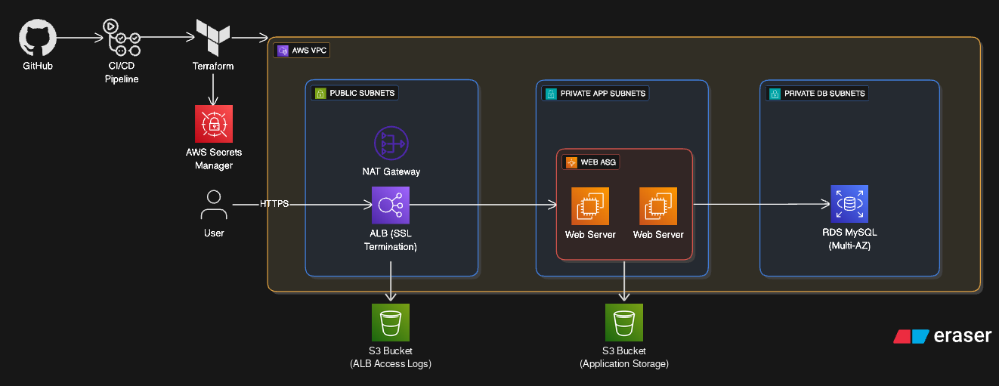

# Savitar Infotel AWS Infrastructure

Terraform project for deploying a three-tier web application on AWS. GitHub
Actions runs Terraform for the `dev`, `staging`, and `prod` environments.

## Architecture




The Terraform configuration provisions a VPC with public, private application,
and private database subnets. An internet-facing Application Load Balancer
terminates HTTPS and forwards traffic to web instances managed by an EC2 Auto
Scaling Group. The web tier connects to a MySQL RDS database. EC2 retrieves the
database password from AWS Secrets Manager using its IAM role. ALB access logs
are delivered to an existing S3 bucket.

## Repository layout

| Path | Purpose |
| --- | --- |
| `infra/envs/` | Terraform root module, environment variable files, and remote-state configuration |
| `modules/network/` | VPC, subnets, gateways, routing, and network controls |
| `modules/application/` | ALB, web tier, database, IAM, and Secrets Manager resources |
| `.github/workflows/terraform.yaml` | Terraform plan, apply, and manual workflows |
| `diagram.png` | Architecture and deployment diagram |

## Prerequisites

- Terraform `>= 1.6.0` and AWS CLI for local operations.
- An AWS account and credentials with permissions to provision the resources.
- An ACM certificate in the **same AWS region as the ALB** (`us-east-1` in
  the current workflow) that covers the hostname you will use.
- An S3 bucket for ALB access logs, in the ALB's region, with a bucket policy
  allowing the ALB log-delivery service to write objects under
  `AWSLogs/<AWS_ACCOUNT_ID>/*`.
- A remote Terraform state S3 bucket. A DynamoDB lock table can also be
  configured for state locking.
- DNS access for your domain, for example through GoDaddy.

The log bucket and remote state bucket are separate resources with different
purposes. Create and configure them before running Terraform.

## GitHub Actions setup

In **Settings → Secrets and variables → Actions**, configure:

### Repository or environment variables

| Name | Required | Purpose |
| --- | --- | --- |
| `ALB_ACCESS_LOG_BUCKET` | Yes | Existing S3 bucket name for ALB access logs |
| `TF_BACKEND_BUCKET` | Yes | Existing S3 bucket used for Terraform remote state |
| `TF_BACKEND_DDB_TABLE` | No | DynamoDB table used for Terraform state locking |

For environment-specific values, create the variables in each GitHub
environment (`dev`, `staging`, and `prod`); otherwise use repository variables.
The workflow selects the matching GitHub environment when it runs.

### Secrets

| Name | Required | Purpose |
| --- | --- | --- |
| `AWS_ROLE_ARN` | Yes | IAM role assumed by GitHub Actions through OIDC |
| `DB_PASSWORD` | Yes | Database master password passed to Terraform as a secret |

Configure the AWS IAM role's OIDC trust policy for this GitHub repository and
grant it the permissions needed by the Terraform resources and remote state.
Do not put credentials or database passwords in committed `.tfvars` files.

## Environment configuration

Environment values are in:

- `infra/envs/dev/terraform.tfvars`
- `infra/envs/staging/terraform.tfvars`
- `infra/envs/prod/terraform.tfvars`

Review the selected file before deploying. In particular, verify its
`certificate_arn`, `domain_name`, and `subdomain` match the intended
environment. The application hostname is
`<subdomain>.<domain_name>`. The certificate must be **Issued** and cover that
hostname.

## DNS and HTTPS

The Terraform configuration creates the ALB and HTTPS listener, but it does
not create DNS records in GoDaddy.

1. Obtain the ALB hostname from Terraform's `load_balancer_dns_name` output.
2. In GoDaddy's DNS settings, create a CNAME record:
   - **Host/Name:** the environment's `subdomain` value.
   - **Points to/Value:** the ALB DNS hostname, without `https://`.
3. After DNS propagates, open `https://<subdomain>.<domain_name>`.

The ALB redirects HTTP requests to HTTPS. A certificate mismatch can still
occur if the certificate does not cover the custom hostname; the generated
`*.elb.amazonaws.com` address generally does not match the custom-domain
certificate.

## Deploy with GitHub Actions

The `terraform` workflow runs automatically for pull requests and pushes to
`env/dev`, `env/staging`, and `env/prod`. Pull requests run a plan; pushes run
an apply. It also supports manual **plan**, **apply**, and **destroy** actions
from **GitHub → Actions → terraform → Run workflow**.

Destroy is destructive. Follow the workflow's confirmation and approval
requirements, and verify backups before proceeding.

## Run Terraform locally

From the repository root, initialize the environment module and choose an
environment's variable file. Provide AWS credentials through your normal AWS
CLI profile or environment configuration. Set the required values securely
for your PowerShell session:

```powershell
$env:TF_VAR_alb_access_log_bucket = "si-access-logs-alb"
$securePassword = Read-Host "Database password" -AsSecureString
$env:TF_VAR_db_password = [System.Net.NetworkCredential]::new("", $securePassword).Password

terraform -chdir=infra/envs init
terraform -chdir=infra/envs plan -var-file="dev/terraform.tfvars"
# Review the plan before applying:
terraform -chdir=infra/envs apply -var-file="dev/terraform.tfvars"

Remove-Item Env:TF_VAR_db_password
Remove-Item Env:TF_VAR_alb_access_log_bucket
```

Replace `dev` with `staging` or `prod` as appropriate. The root Terraform
configuration uses an S3 backend; for local initialization, provide the
backend configuration required by your state bucket, for example with
`-backend-config` options. Do not run an apply until you have reviewed the
plan and confirmed the selected AWS account and environment.

## Useful references

- [Step-by-step project guide](docs/PROJECT_GUIDE.md)
- [Environment Terraform usage](infra/envs/README.md)
- [Manual GitHub Actions workflows](docs/MANUAL_WORKFLOWS.md)
- [Security guidance](SECURITY.md)
